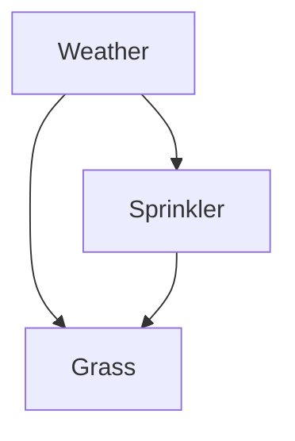
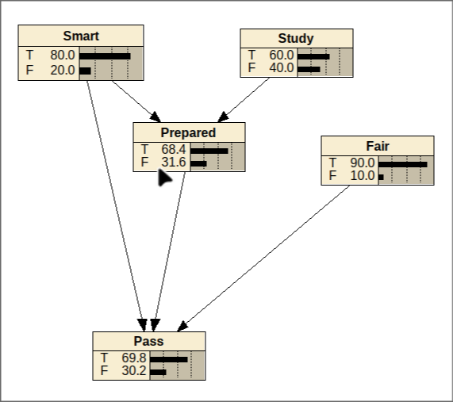
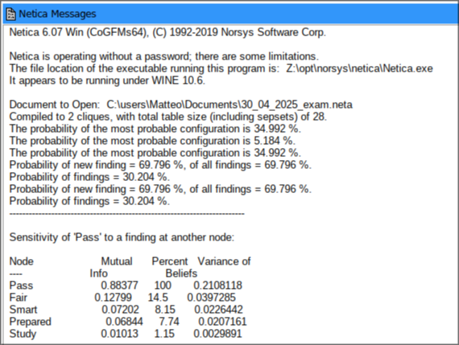

# Bayesian networks

## Information on the course

### Lectures time

- Wednesdays 10:30 - 13:00 (He might contact us to actually do 11:00 - 13:30 sometimes)
- Sometimes lectures might end early if we are assigned specific tasks that we might decide to do at home or in class with the professor supervision

### Exam

- Project on this specific part (or something else, still need to be confirmed by the professors)

### Materials

Mostly papers and/or links on the slides. (Books aren't really available on this topic yet)

## Basics of Bayesian networks

Reference paper: <https://doi.org/10.1609/aimag.v12i4.918>

We can see that it was published on an AI magazine. This is probably an old view on Bayesian networks as nowadays the applications of this kind of net is usually different from AI.

Bayesian networks are used today in order to be able to obtain certifications for critical systems. One of the main positive issues of Bayesian networks is that they are transparent and they aren't a black box.  
Bayesian networks are usually seen as a good compromise between FT and PN in terms of **expressive powers**, **efficiency** and **easy of use**.

In particular:

- **Fault trees** are usually very efficient and easy to use but they have many limitations that don't allow to express complex dependencies
- **Petri nets** are very expressive and actually it has been proven that the language of Petri nets is Turing complete. The issue with the Petri nets is that they are not easy to use and they are not efficient. There is a well known problem knows as the **exponential state space explosion problem**.

*Note:* There are specific situation and relationships that **cannot be expressed** with Bayesian networks and therefore we will have to resort to Petri nets (most likely)

### Some very common applications of Bayesian networks

They are especially suitable for diagnostic applications. They can be used for **multi-sensor** information fusion leveraging on redundancy and diversity to improve the trustworthiness of the event detection.

They are preferred in some situations because they are a white box and therefore they are easier to understand and to explain.

They are easy to extend. Some famous extensions of Bayesian networks are **Time-Varying Bayesian networks** and **Dynamic Bayesian networks**.

### Some definitions

A Bayesian network is a **directed acyclic graph** (DAG) where:

- *Nodes* represent stochastic variables
- *Edges* represent the probabilistic dependencies between the variables

All the dependencies are quantified in the form of **conditional probability tables** which are embedded in the model.

*Example:*

- Weather:
  - Sunny
  - Cloudy
  - Rainy
- Grass:
  - Wet
  - Dry
- Sprinkler:
  - On
  - Off

Graphical representation:

**Causal links:**

- If it's rainy, the grass is wet
- If it's sunny for a long time, the grass will become wet cause the sprinkler will turn on

### Why this name?

The name of Bayesian networks comes from the fact that they are based on **Bayes' Rule**.

Bayes' Rule is a theorem that describes the relationship between conditional probabilities. It states that the probability of an event A given event B is equal to the probability of event B given event A multiplied by the probability of event A divided by the probability of event B:

$$
P(A|B) = \frac{P(B|A) \cdot P(A)}{P(B)}
$$

Where:

- \(P(A|B)\) is the conditional probability of event A given event B
- \(P(B|A)\) is the conditional probability of event B given event A
- \(P(A)\) is the prior probability of event A
- \(P(B)\) is the prior probability of event B

### How this extends to Bayesian networks

The **joint probability** of all the variables can be computed as follows:

$$
P(X_1, X_2, \ldots, X_n) = P(X_1) \cdot P(X_2|X_1) \cdot P(X_3|X_1, X_2) \cdots P(X_n|X_1, X_2, \ldots, X_{n-1})
$$

Where \(X_1, X_2, \ldots, X_n\) are the variables in the Bayesian network.

### Why we need the acyclic property

The acyclic property is important because if we had cycles, we would have to deal with **infinite loops** and **infinite recursion**.

Moreover it solves issues that might arise from the fact that we wouldn't know how to compute specific probabilities.

### Softwares

We will use Norsys Netica. There are other alternatives and/or APIs that do the same. *Note:* for the exam we can use whatever we want

*First example with netica:*
*Note:* check the slides for the specification of probability

### Some Netica features

#### Most probable explanation

The most probable explanation (MPE) is the most likely assignment of values to all the variables in the Bayesian network given the evidence.

#### A posteriori analysis

The **a posteriori analysis** is the process of updating the probabilities of the variables in the Bayesian network given new evidence.

### Sensitivity analysis

The **sensitivity analysis** is the process of determining how sensitive the probabilities of the variables in the Bayesian network are to changes in the parameters of the model.

It answers the question: "How much does the probability of a variable change when we change the parameters of the model?"

The reason why this is very useful is that it allows engineers and workers in general in understanding which part are a good investment and which are not.

### Noisy logic gates

**Noisy-gate** are probabilistic generalizations of logical gates used in Bayesian networks to model the uncertainty in the relationships between the variables.

In real world we have that:

- causes don't always deterministically lead to effects
- each cause might succeed or fail independently in triggering an effect

The noisy gate allows to model this kind of imperfection.

*Example:* In the image above we can see that even if the student is smart and studies, still he won't have a 100% probability to be prepared, but instead he has a 90% probability of being prepared. If we look at this from a logical point of view we can say that the student might have studied on a book that doesn't cover all the topics of the exam or some other kind of mishap happened. Again, even if the student is prepared and is also smart, the student might still not pass the exam, and therefore even if the exam is fair he only has a 90% probability to pass. From a logical point of view we can say that maybe the students is not feeling well or he just commits very trivial mistakes or the test might be fair but hard.

### Efficiency

The inference in Bayesian networks in general **is NOT efficient**. In particular it can be proven that the inference in Bayesian networks is **NP-hard**.

This means that in general the inference is even less efficient than the inference in Petri nets. The point is that if the graph actually has a **tree structure** then the inference is **polynomial**.

*Note:* A very common use of Bayesian networks is also for **multiformalism**. This means that we can use Bayesian networks to join different part of the models that use different kinds of representation.
